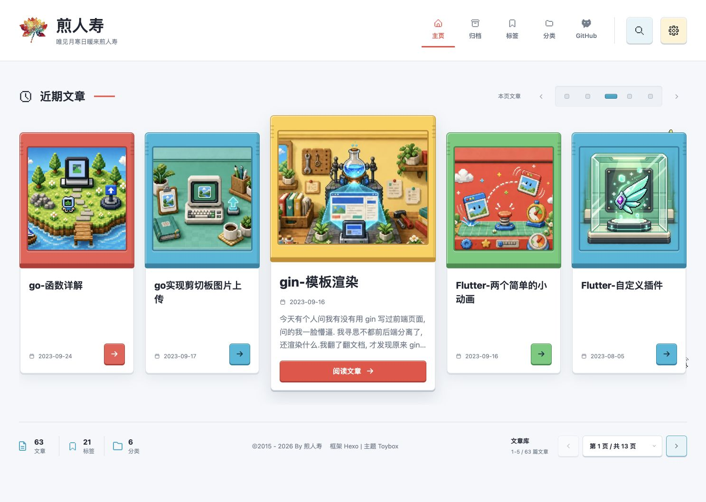

# Hexo Theme Toybox

[](https://github.com/DipsySu/hexo-theme-toybox/actions/workflows/ci.yml)
[](https://dipsysu.github.io/hexo-theme-toybox/)
[](LICENSE)
[](https://hexo.io/)

Toybox 是一个独立维护的 Hexo 像素卡带主题。它把首页做成桌面卡带陈列架，
并让文章、分类、标签与归档沿用同一套彩色塑料卡带、轻量导航和阅读排版。



[打开在线 Demo](https://dipsysu.github.io/hexo-theme-toybox/)

本分支正在试作 **Pixel Paper Stage**：将像素文章卡片放进纸片舞台，保留原有
切换、分页与阅读功能。线上 Demo 仍为 `main` 版本。试作说明与素材来源见
[纸片舞台说明](docs/paper-stage.md)。

主题所需的布局、样式、脚本、字体和图片都包含在仓库中，不需要向站点
`source` 目录复制额外文件。

## 功能

- 服务端输出卡带架，选中的卡带原位展开，手机端横向浏览
- 同一次构建中跨页面一致的文章封面 fallback（社交分享图与 `og:image` 使用同一张），不覆盖文章显式封面
- 键盘切换、触控滚动与分页过渡
- 翻页、读完文章时短暂出现的像素 Sprite 彩蛋，空闲时偶尔出现
- 本机阅读存档，首页可继续上次未读完的文章
- 文章目录、阅读模式、上一篇/下一篇与相关推荐
- 归档、标签、分类、友情链接和 404 页面
- 即开搜索弹窗、失败重试、图片懒加载、Fancybox 和 Share.js
- Light / Dark / Auto 配色
- English / 简体中文 / 繁体中文界面

## 安装

在 Hexo 站点根目录运行：

```bash
git clone --depth=1 https://github.com/DipsySu/hexo-theme-toybox.git themes/toybox
npm install hexo-renderer-pug hexo-renderer-stylus
```

然后在站点 `_config.yml` 中启用主题：

```yml
theme: toybox
```

本地搜索需要额外安装 `hexo-generator-searchdb`；文章字数功能需要
`hexo-wordcount`。未安装时请保持对应选项关闭。

## 配置

将主题的 `_config.yml` 复制为站点根目录 `_config.toybox.yml`，以后只修改站点
覆盖文件，更新主题时就不会覆盖你的配置。

```yml
local_search:
  enable: true
  preload: true

wordcount:
  enable: true

toybox:
  appearance: paper # paper / cartridge，切回 cartridge 可恢复原版外观
  home:
    fallback_covers:
      - src: /img/home-toybox/featured-island.webp
      - src: /img/home-toybox/card-aqua-scene.jpg
  settings:
    enable: true
    color_mode:
      default: auto # light / dark / auto
    locale:
      default: zh-CN # en / zh-CN / zh-TW
```

头像、站点图标和菜单可以通过 `avatar`、`favicon`、`nav` 与 `menu` 配置覆盖。

主题不再加载 Font Awesome，所有图标都是 `source/css/pixel-icons.css` 中的像素蒙版。
`menu` 里的图标仍写作 `fas fa-<名称>` / `fab fa-<名称>`，但只支持已绘制的类名：
`fa-home`、`fa-archive`、`fa-tag`、`fa-tags`、`fa-folder`、`fa-folder-open`、`fa-github`、
`fa-envelope`、`fa-search`、`fa-book-open`、`fa-bookmark`、`fa-gamepad`、`fa-inbox`、
`fa-history`、`fa-clock`、`fa-calendar-alt`、`fa-file-alt`、`fa-list-ul`、`fa-th`、
`fa-eye`、`fa-cog`、`fa-bars` 等（完整列表见该文件）。其他类名会显示为空白占位。

首页推荐在站点 `_config.yml` 中设置 `per_page: 5`。默认封面优先使用
`cover.default_cover`，未设置时使用主题自带的 `toybox.home.fallback_covers`。
后备图片按文章时间排序循环分配；新增文章可能改变分配（包括社交平台缓存的分享图）。
需要永久固定图片的文章请在 front matter 中显式设置 `cover`。设置 `cover: false`
仍可关闭该文章封面。

图片懒加载（`lazyload.field: site`）只处理没有声明加载方式的图片：带有 `loading`
属性或 `data-no-lazy` 属性的 `` 保持原样交给浏览器。导航图标、侧栏头像和首页
舞台上的前五张卡带封面随页面直接加载（第一张带 `fetchpriority="high"`），其余卡带
封面使用原生 `loading="lazy"`。

主题 CSS/JS 链接中的 `?v=` 由文件内容生成：文件不变，链接就不变，未修改主题的
部署不会让访客重新下载这些资源；由 Stylus 生成的 `index.css` 随主题样式源文件和
主题配置变化。可以为带 `?v=` 的请求设置长期缓存，例如 Nginx：

```nginx
map $arg_v $toybox_cache_control {
  ""      "no-cache";
  default "public, max-age=31536000, immutable";
}
# server { ... add_header Cache-Control $toybox_cache_control; }
```

相关推荐按共同标签数、发布时间、路径排序，每次构建结果一致。文章目录只在文章页
显示，可在 front matter 中用 `toc: false` 关闭。404 页面图片可用
`error_404.background` 设置，默认使用 `error_img.post_page`。

页面与组件规范见 [Cartridge Library 设计规范](docs/cartridge-library.md)。

## 更新

```bash
git -C themes/toybox pull --ff-only
npx hexo clean
npx hexo generate
```

更新前请确认个性化配置都保存在站点根目录 `_config.toybox.yml`。
升级后清理 Hexo 缓存，以移除旧布局记录。主题会忽略仓库内 `demo` 的生成目录，
避免本地开发示例站覆盖实际站点的模板。

以下旧配置已不再生效，可以从 `_config.toybox.yml` 中删除：`toc.page`、
`toc.style_simple`、`rightside_item_order`、`css_prefix`（不再输出旧浏览器前缀）、
`anchor.button.icon` 与 `beautify.title-prefix-icon`（改用像素图标）、
`asset.fontawesome` 与 `asset.typed`、`aside.display` 与 `cover.position`，以及
首页隐藏标题区使用的 `subtitle` 与 `social`（站点副标题仍由站点 `_config.yml` 的
`subtitle` 显示在导航中）。

## 功能边界

阅读存档只保存在当前浏览器中，按站点根路径隔离，不上传、不跨设备同步。
点击首页「继续阅读」才恢复阅读位置，普通文章链接不自动跳转。读完或清除存档
后入口隐藏；清除存档不会重置配色、语言或已读记录。浏览器禁止本地存储时，
文章阅读和导航仍可正常使用。

Toybox 不内置评论系统、聊天、广告、播放器、数学公式、PWA 或 PJAX。这些能力
需要时应作为站点级扩展接入，避免主题重新变成臃肿的集成包。

## 开发

测试、内置 Pages 示例站与提交约定见 [CONTRIBUTING.md](CONTRIBUTING.md)。`main`
分支更新后，GitHub Actions 会自动重新部署在线 Demo。

## 许可与致谢

Toybox 使用 [Apache-2.0](LICENSE) 许可证。主题早期基于
[Hexo Theme Butterfly](https://github.com/jerryc127/hexo-theme-butterfly) 的
Apache-2.0 代码演进而来，相关署名见 [NOTICE](NOTICE)。Pixelarticons 图标许可见
`source/img/pixel-icons/LICENSE`，Fusion Pixel 字体许可见
`source/fonts/LICENSE-Fusion-Pixel-OFL.txt`。
